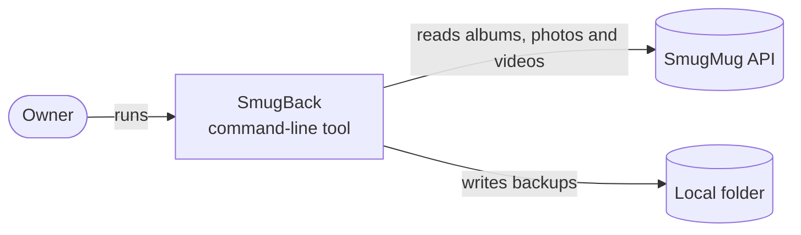
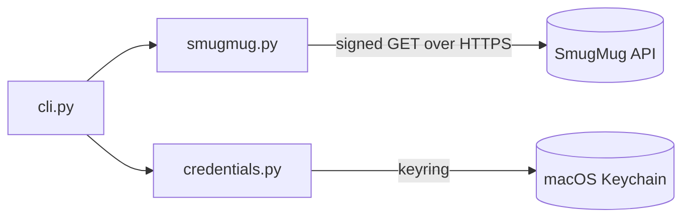

# Architecture

How SmugBack is built, at two levels of the [C4 model](https://c4model.com/):
**context** (the system and the people and systems around it) and **containers** (the
deployable parts and how they talk). Diagrams are written in Mermaid so GitHub renders
them. Keep this current through CRs.

## System context

The owner runs SmugBack on their own computer. It reads their account from SmugMug's
API and writes copies of their photos and videos to a local folder. It never changes
anything on SmugMug.

## Containers

One container: the `smugback` Python package (`src/smugback/`), run as a command. There
is no server or database. Inside it:

- `cli.py`: the `login`, `logout` and `albums` commands (entry point
  `smugback.cli:main`).
- `smugmug.py`: OAuth 1.0a sign-in and the read-only API client (ADR-0006).
- `credentials.py`: reads and writes the one Keychain item that holds the credentials
  (ADR-0003).

